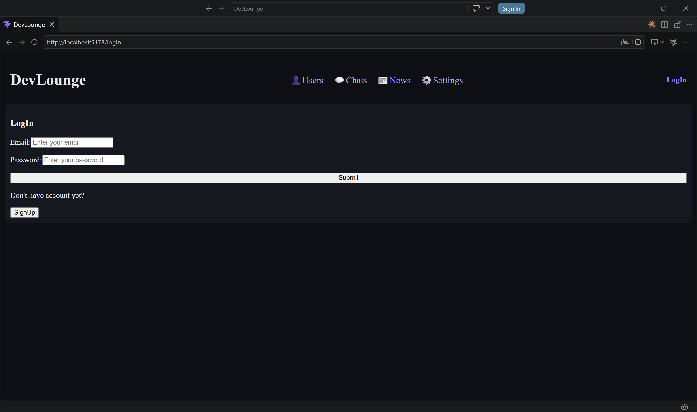

# DevLounge

A small community app for developers: find people, chat in real time, and read dev news.

**Live demo:** https://devlounge-mu.vercel.app



## Features

- Sign up and log in with email and password
- Members list with search and a filter by position (frontend / backend / fullstack)
- Member profiles
- Private messages that appear in real time, without reloading the page
- Chats list with the last message of each conversation
- News feed from dev.to with search by tag
- Edit your own name, position and status
- Choose a default tag for the news feed
- Pages are only available after logging in (except News and Login)

## Tech stack

| Technology         | Why I used it                                                                                                      |
| ------------------ | ------------------------------------------------------------------------------------------------------------------ |
| React + TypeScript | UI built from components; TypeScript catches mistakes before the app runs                                          |
| React Router       | Every page has its own URL (`/chats`, `/profile/:id`, ...)                                                         |
| Zustand            | Shared state for many components without passing props, e.g. the logged-in user. Settings are saved with `persist` |
| React Query        | Loads data from Supabase and dev.to, caches it, and gives ready loading / error states                             |
| Supabase           | Backend without writing my own server: database, authentication and realtime updates                               |
| Vercel             | Hosting; every push to GitHub deploys a new version                                                                |

## A decision I made myself

- **Debounce in the news search.** The search waits 500 ms after the last key press before sending a request. Without it, typing "react" would send five requests: `r`, `re`, `rea`, `reac`, `react`. I built it with `useEffect` and `setTimeout`, and `clearTimeout` in the cleanup.

## What I learned

- **Rules of Hooks.** React remembers hooks by their order. I got the error "change in the order of Hooks" twice because I returned early (`if (isPending) return ...`) before some hooks. Now my components follow one order: hooks → early returns → calculations → JSX.

## Run locally

1. Install dependencies:
   ```
   npm install
   ```
2. Create a Supabase project and run [`supabase/schema.sql`](./supabase/schema.sql) in its SQL Editor. It creates the tables and the access rules.
3. Create a file `.env.local` in the project root with your Supabase keys:
   ```
   VITE_SUPABASE_URL=your-project-url
   VITE_SUPABASE_PUBLISHABLE_KEY=your-publishable-key
   ```
4. Start the dev server:
   ```
   npm run dev
   ```
